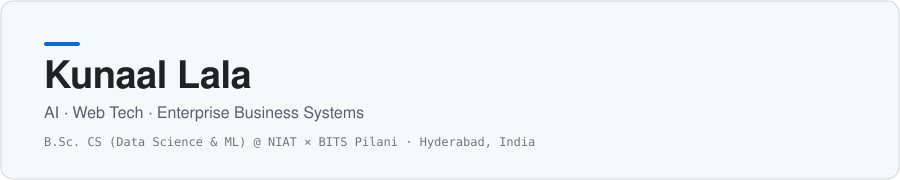

  <picture>
    <source media="(prefers-color-scheme: dark)" srcset="./header-dark.svg">
    <source media="(prefers-color-scheme: light)" srcset="./header.svg">
    
  </picture>

  
<em>Building practical software where applied AI, web tech, and enterprise business systems meet.</em>

## About

- **Education:** 3rd-year B.Sc. Computer Science (Data Science & ML) at **NIAT × BITS Pilani** (Hyderabad) · **McKinsey Forward ’26** learner.
- **Experience:** Completed a 1-year internship at **OHO Solutions** (Kochi, Aug 2025 – Aug 2026), building **Zoho CRM, Zoho Books, Zoho Creator, and Deluge** workflow automations for a healthcare client to replace manual handoffs with integrated APIs and business logic.
- **Certifications:** Udacity Future AWS AI Programmer · Meta Full Stack Developer · DeepLearning.AI AI Python for Beginners · IBM Getting Started with Git and GitHub.
- **Looking for:** Data, business-systems, and applied-AI internships or entry-level roles.

## Featured Projects

| Project | What it does | Stack | Links |
| :--- | :--- | :--- | :--- |
| **RocPort Labs** (`cuda-migrator`) | Automated CUDA-to-ROCm/HIP kernel migration engine using tree-sitter AST parsing, 65 deterministic rules, and compile-validated LLM fallback *(AMD Slingshot 2026)* | Python, tree-sitter, CUDA / ROCm HIP | [GitHub](https://github.com/kunaalxoxo/cuda-migrator) |
| **Ration Saathi** | Voice-first, multilingual IVR platform for India's Public Distribution System (PDS) with grievance tracking and FPS risk scoring *(BITS APOGEE 2026 KRITI Social Impact Challenge)* | Python (FastAPI), React, Supabase, Twilio, Bhashini, Groq | [GitHub](https://github.com/kunaalxoxo/ration-saathi) · [Live](https://ration-saathi.vercel.app) |
| **FixStack** | Autonomous multi-agent dependency security auditor that checks CVE exploitability in source context and opens semver-safe patch PRs | TypeScript, Node.js, Groq, OSV.dev, NVD, GitHub API | [GitHub](https://github.com/kunaalxoxo/fixstack-backend) · [Live](https://fixstack-backend.vercel.app) |

## Tech Stack

**Daily drivers** — core tools I use comfortably in coursework and production workflows:

**Currently learning** — building with these across recent projects and actively deepening fluency:

## GitHub Stats

<!-- Note: The public github-readme-stats.vercel.app instance can occasionally hit rate limits. If these cards stop rendering, swap to a self-hosted Vercel deployment or a GitHub Actions-generated stats SVG committed via workflow. -->

  
  

  

## Connect

  
  

